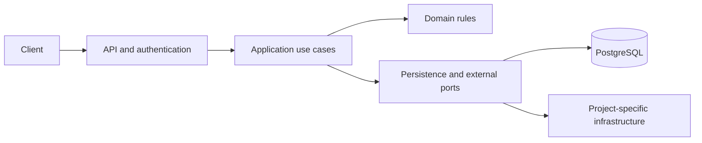

# FleetStream — Backend Developer Track

**Project 5 of 8 · Java 21 · Spring Boot 3.5.16 · Maven 3.9.9 · PostgreSQL**

> Start with [Getting Started](docs/GETTING_STARTED.md), then [Submission Rules](docs/SUBMISSION_RULES.md). The complete rules are below; milestone checklists point back here.

## 1. Overview

Build **FleetStream**, a backend for **reactive telemetry and live fleet monitoring**. You implement the application, data model, API and failure handling. The learning focus is: Spring WebFlux, Reactor, R2DBC, Kafka, SSE, WebSocket, backpressure, ordering, event time, replay, bounded resources, reactive security and observability.

This is original learning material organized like the supplied `substream.zip`: numbered specification, stable business-rule IDs, M1–M3 shared milestones, D4–D7 developer milestones, an AQA guide and reflection. It is not connected to the SubStream/NIX grading bot. The reference project is [SubStream](https://github.com/Abd-Elrahman3/SubStream-Developer-Track); no completed solutions or proprietary bot are included.

## 2. How the Challenge Works

### 2.1 Milestones

Do projects in order. Prerequisite: complete D7 of [CourseGraph](https://github.com/Abd-Elrahman3/04-coursegraph-spring-boot) and explain its failure drills.
Every milestone is required. Advanced requirements are part of completion, not optional stretch goals. M1–M3 establish the model, database and transactions; D4–D7 add contracts, difficult behavior, failure recovery and operation.

| Milestone | Goal | Branch | Guide |
| --- | --- | --- | --- |
| M1 | Domain and invariants | `feature/m1-domain` | [Shared](docs/SHARED_MILESTONES.md) |
| M2 | Database and persistence | `feature/m2-database` | [Shared](docs/SHARED_MILESTONES.md) |
| M3 | Transactional use cases | `feature/m3-transactions` | [Shared](docs/SHARED_MILESTONES.md) |
| D4 | API contracts and authorization | `feature/d4-api` | [Developer](docs/TRACK_DEVELOPER.md) |
| D5 | Advanced behavior and resource limits | `feature/d5-advanced` | [Developer](docs/TRACK_DEVELOPER.md) |
| D6 | Failure testing and recovery | `feature/d6-failures` | [Developer](docs/TRACK_DEVELOPER.md) |
| D7 | Operations and design defense | `feature/d7-operations` | [Developer](docs/TRACK_DEVELOPER.md) |

### 2.2 Levels

Bronze = M2; Silver = D4; Gold = D6; Platinum = D7 **with evidence**. Complete Platinum before progressing to the next project. A blocked feature should get a smaller reproducible experiment; do not mark it complete by removing its assertion.

### 2.3 How your work is evaluated

The starter compiles and runs only packaging tests by default. Behavioral examples and test exercises intentionally fail. `python3 scripts/check_progress.py --through M1` runs the cumulative milestone tests and checks evidence; advance through D7. The workflow runs this gate on milestone PR branches. A green starter build proves packaging only.

Automation is a guardrail, not proof of understanding. You own these repositories and can bypass local checks; keep the gates intact, review tests and explain tradeoffs aloud. There is no hidden evaluator and branch protection is not configured by these files.

## 3. Architecture



The API binds and validates transport input. The service establishes authorization and transaction boundaries. Domain objects enforce state rules. Persistence adapters map database data without leaking entities to API responses. Dependencies and clocks are constructor-injected. Reactor publishers represent asynchronous completion; compose them, including transactions and errors.

See [Database Requirements](docs/DATABASE_REQUIREMENTS.md), [API Requirements](docs/API_REQUIREMENTS.md) and [Architecture Decisions](docs/ARCHITECTURE_DECISIONS.md) for this project's concrete boundaries.

### 3.1 How the classes relate

| Area | Responsibility |
| --- | --- |
| domain | TelemetryPoint, Device, Geofence, Alert |
| service | Use cases, transaction boundary and principal-derived identity |
| repository / persistence | Ports, SQL/JPA/R2DBC mappings, constraints and query strategy |
| api | DTOs, controllers/resolvers, validation and error mapping |
| advanced | Required project-specific workers, policies and adapters |
| config | Dependency injection, Clock, security, typed configuration |

## 4. Domain Model

| Type | Fields / types | Invariant |
| --- | --- | --- |
| TelemetryPoint | UUID eventId; UUID deviceId; long sequence; Instant recordedAt; double latitude; double longitude | Sequence >=0; latitude [-90,90], longitude [-180,180]; finite coordinates only. |
| Device | UUID id; String ownerSubject; long lastSequence; Instant lastSeenAt | Authorization subject must own or be assigned to the device. |
| Geofence | UUID id; UUID deviceId; double centerLatitude; double centerLongitude; double radiusMeters | Radius 10..100000 meters; boundary counts as inside. |
| Alert | UUID id; UUID deviceId; UUID sourceEventId; String type; Instant createdAt | One ENTER/EXIT transition effect per source event and geofence. |

Fields are private. Do not add public state setters to bypass business methods. A rejected domain operation changes nothing. IDs are UUIDs unless explicitly stated otherwise. Identity equality uses persistent ID; value objects use their values. Store timestamps as UTC `Instant`; use `LocalDate` only for calendar-date rules. Nullability is explicit in database/API specs; unknown IDs are never treated as empty success. Use `ConflictException` for invalid state transitions and `IllegalArgumentException` for invalid domain values. Constructor signatures in starter examples are stable; you may add overloads, private fields and new classes as requirements grow.

The declared fields and constructors are scaffolding; constructors and business methods throw `UnsupportedOperationException("TODO: ...")`. Getters, enum values, Clock and the application entry point are provided. See [Starter Map](docs/STARTER_MAP.md).

## 5. Business Rules

Rule IDs are local to this repository. Each rule includes a concrete acceptance example. Full behavior, boundaries and failures matter; the examples are a starting test set.

### M1 — Domain and invariants

#### BR-101 — Validate telemetry

Reject nonfinite coordinates, out-of-range latitude/longitude, negative sequence and timestamps over 2 minutes in the future relative to injected Clock. Data no older than seven days is allowed but classified late; older data is rejected at ingress. Use immutable values.

**Acceptance example:** Latitude -90 and 90 accepted; NaN and infinity rejected; timestamp exactly now+2m accepted.

#### BR-102 — Specify geofence transitions

Use a documented haversine formula and Earth radius 6,371,000m. distance<=radius is inside. Initial point establishes state without alert; subsequent inside/outside transitions emit ENTER/EXIT. Late points never reverse current geofence state.

**Acceptance example:** Center point inside; repeat identical point emits nothing; first outside observation establishes state; outside→inside emits one ENTER.


### M2 — Database and persistence

#### BR-201 — Persist reactively

Use PostgreSQL via R2DBC for request processing; Flyway migrations may run via JDBC during startup in a separate initialization phase. No JDBC/JPA calls on event-loop threads. Separate ingress_keys and consumer processed_events prevent duplicate acceptance and duplicate effects respectively; preserve payload hashes to detect conflicting duplicates (see Implementation Labs).

**Acceptance example:** Same device/sequence and same payload → dedup; same sequence with different coordinates → 409 for direct ingress or quarantine for broker consumption.

#### BR-202 — Partition and retain history

Partition telemetry by recorded date with a documented strategy for global event dedup keys in a separate table. Retain telemetry 7 days and replay cursors 24h; indexes support (device_id,sequence). Separate current device projection from raw history.

**Acceptance example:** Drop an expired partition without deleting current device state or recent dedup keys; query a device range using an index.


### M3 — Transactional use cases

#### BR-301 — Accept durably before acknowledging

REST batch ingress allows 1..500 points and max 1MiB. Validate entire batch; write ingestion records plus outbox in one reactive transaction then return 202 receipt. No 202 before durable commit. Publish to Kafka keyed by deviceId with acknowledgments; consumer owns history/projection updates.

**Acceptance example:** Kill Kafka: accepted batches remain in outbox and recover. Kill DB: ingress returns 503, never 202.

#### BR-302 — Handle ordering and gaps

Kafka preserves partition order, not global order. Device projection advances only for sequence>lastSequence. Gaps are recorded as missing ranges, never block all later events. Late arrivals fill history/gaps but do not roll back the projection. Commit consumed offset only after DB transaction; replay dedups.

**Acceptance example:** Receive sequences 10,12,11,12: projection ends at 12, gap 11 is resolved, history has each point once and effects do not duplicate.


### D4 — API contracts and authorization

#### BR-401 — Stream resumable SSE

GET device events emits text/event-stream with event ID as persisted monotonic per-device sequence. Last-Event-ID requests strictly later events; send a heartbeat every 15s. Resume outside the 24h replay window → 410 before opening stream. Validate authorization before headers.

**Acceptance example:** Disconnect after 12, reconnect with Last-Event-ID:12 → next event is >12, even after application restart.

#### BR-402 — Authenticate WebSockets

Use a short-lived one-use ticket obtained over authenticated REST; consume it at handshake. Ticket TTL 30s, stored hashed, bound to subject+device+allowed origin. Never put bearer JWT in the URL. Authorize each device subscription and close when authorization expires.

**Acceptance example:** Reusing a ticket, wrong origin, expired ticket and subscribing to another owner’s device are rejected.


### D5 — Advanced behavior and resource limits

#### BR-501 — Apply explicit backpressure

Each connection has a buffer of at most 256 events and a max lifetime of 1h. A slow SSE subscriber is disconnected when full and resumes from persisted cursor; do not silently drop events. Bound flatMap concurrency and broker prefetch. Global connection cap 1,000 per instance returns 503 above cap.

**Acceptance example:** A client reading 1 event/s while ingress is 100/s cannot grow heap indefinitely; other clients remain responsive.

#### BR-502 — Avoid blocking and leaks

No block(), subscribe() fire-and-forget, Thread.sleep or blocking IO in request pipelines. Compose Mono/Flux with cancellation cleanup. Use boundedElastic only for an unavoidable adapter with a documented bound, never for the core R2DBC flow.

**Acceptance example:** Cancel 1,000 streams and show subscriber counts, timers and pooled connections return near baseline.


### D6 — Failure testing and recovery

#### BR-601 — Test time and demand

Use StepVerifier with virtual time for heartbeat/backoff and Testcontainers for PostgreSQL+Kafka. Test bounded demand, cancellation, poison events and rebalance redelivery. WebTestClient validates both finite responses and initial SSE events.

**Acceptance example:** Removing cancellation cleanup or acknowledging before DB commit must break a required test; no arbitrary sleeps as synchronization.

#### BR-602 — Rebuild projections

Rebuild current device/geofence projections from retained history into shadow tables, then switch readers after validation. State the 7-day reconstruction limit and how a baseline snapshot supports earlier history. Rebuilding must not re-send historical alerts.

**Acceptance example:** Compare shadow/current counts and state for 100 devices after disorder and duplicates; notifications stay unchanged.


### D7 — Operations and design defense

#### BR-701 — Measure throughput and resource limits

Benchmark 1,000 points/s for 5 minutes with 100 connected streams; target p95 accepted batch latency <250ms and event visibility <2s on the documented hardware. Capture heap, event-loop lag, consumer lag and pool saturation.

**Acceptance example:** Report actual results with dataset/config, including failures and bottleneck; a throughput claim without latency/lag evidence does not pass.

#### BR-702 — Operate across failures

Run two app instances, terminate one during streaming, reconnect through the other and replay using persisted cursors. Rotate credentials and restart Kafka without losing acknowledged ingestion intents. Document limits, overload responses and retention.

**Acceptance example:** Final evidence shows duplicate tolerance, bounded buffers, failover recovery and why reactive code alone does not make a system faster.

## 6. Provided Infrastructure

Provided: pinned Maven build/wrapper, application entry point, UTC Clock bean, domain/API/repository/advanced stubs, Docker Compose, environment example, migration placeholder, API contract examples, packaging tests, intentionally red learning tests, CI and a cumulative gate. PostgreSQL migrations, business logic, authentication policy, transport handlers and behavior tests remain your work. Initial startup is not claimed until the required schema/configuration is implemented.

External providers must be mocked locally. No real payments, messages to customers or paid cloud accounts are needed. Install only the components required for the current milestone. See setup instructions for versions and ports.

## 7. Project Structure

```text
README.md                     full model and business rules
REFLECTION.md                 evidence of understanding
docs/GETTING_STARTED.md        setup and first milestone
docs/SHARED_MILESTONES.md       M1–M3 checklists
docs/TRACK_DEVELOPER.md         D4–D7 checklists
docs/TRACK_AQA.md               mandatory complementary testing track
docs/SUBMISSION_RULES.md        branches, commits, completion rules
docs/DATABASE_REQUIREMENTS.md  schema, constraints, indexes, migrations
docs/API_REQUIREMENTS.md       transport, status, auth and payload rules
docs/ACCEPTANCE_TESTS.md        failure and boundary test matrix
docs/ADVANCED_BACKEND_GATES.md  non-optional completion evidence
docs/LEARNING_PATH.md           eight-project progression
docs/primers/                  short concept guides and official references
docs/aqa/                      API test guidance
docs/evidence/                 fill after reproducing each milestone
pom.xml, mvnw, .mvn/            pinned build and wrapper
src/main/java/                unfinished application
src/test/java/                packaging checks and learning tests
src/main/resources/           application config and migration placeholder
api/                          contract and request examples
compose.yaml, .env.example     local infrastructure
scripts/check_progress.py     cumulative learning gate
.github/workflows/            starter build and milestone gate
```

## 8. What Good Code Looks Like Here

Use clear transaction boundaries, immutable DTOs, constructor injection and small use cases. Never depend on H2 to prove PostgreSQL locking/constraints. Never log credentials. Tests assert durable state and externally observable behavior, not only mocked call counts. Keep request/broker buffers bounded and retries limited. Explain every index, retry and trust boundary you introduce. Record actual measurements instead of assuming a technology is faster.

This curriculum covers a broad backend progression; it does not claim to exhaust every Spring module. [Learning Path](docs/LEARNING_PATH.md) maps the concepts and identifies follow-on subjects.

See [Implementation Labs and Contract Details](docs/IMPLEMENTATION_LABS.md) for concrete fixtures, payload semantics and boundary experiments. These are required, not optional extras.
